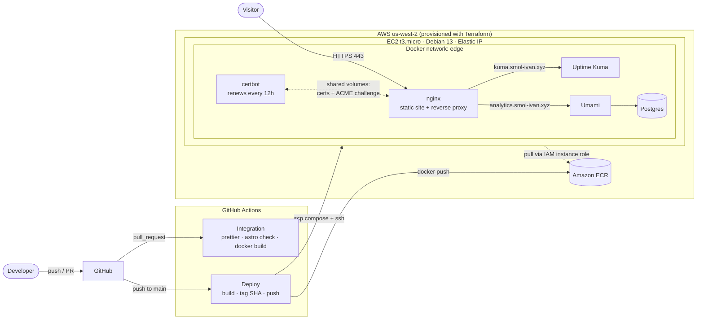

# smol-ivan-web

Personal website and portfolio ([smol-ivan.xyz](https://smol-ivan.xyz)), and my hands-on introduction to cloud infrastructure: **AWS (EC2, ECR, IAM)**, **Terraform**, **Docker**, and **CI/CD with GitHub Actions**.

The site itself is a static [Astro](https://astro.build) build. The interesting part is everything around it: how it is provisioned, packaged, shipped, secured with TLS, and monitored.

> **A note on scope:** a static site would normally be served from S3 + CloudFront, which is cheaper and simpler. I deliberately chose a single EC2 instance to learn the moving parts that managed services hide: provisioning a VM, container networking, reverse proxying, certificate management, and deploying over SSH.

## Architecture



| Layer              | What runs there                                                                                                                                                                                     |
| ------------------ | --------------------------------------------------------------------------------------------------------------------------------------------------------------------------------------------------- |
| **Infrastructure** | Terraform modules for networking (security group), IAM (instance role with read-only ECR access), ECR (repository with scan-on-push) and compute (EC2 + Elastic IP, bootstrapped with `user_data`). |
| **Runtime**        | Docker Compose on a single instance. A multi-stage image builds the site with Node and serves it with `nginx:alpine`.                                                                               |
| **TLS**            | Let's Encrypt via a `certbot` sidecar. nginx serves the ACME challenge from a shared volume and reads the certificates from another.                                                                |
| **Observability**  | Uptime Kuma (uptime checks) and Umami (privacy-friendly analytics), deployed as a separate Compose stack that joins the same `edge` network.                                                        |
| **CI/CD**          | GitHub Actions: validation on every PR, build-push-deploy on every merge to `main`, manual deploy for the monitoring stack.                                                                         |

## Documentation

Deeper write-ups live in [`docs/`](docs/):

- [Pipelines](docs/pipelines.md): every workflow step by step, secrets, rollback, known issues.
- [Infrastructure](docs/infrastructure.md): Terraform modules and instance bootstrap.
- [Runtime](docs/runtime.md): Docker image, Compose stacks, nginx, TLS and networking.
- [Architecture Decision Records](docs/README.md#architecture-decision-records): why each major choice was made.

## Repository layout

```
.
├── src/                          # Astro site (pages, layouts, content collections)
├── Dockerfile                    # Multi-stage: node (build) -> nginx:alpine (runtime)
├── nginx/nginx.conf              # HTTP->HTTPS redirect, ACME challenge, healthz, reverse proxy
├── docker-compose.yml            # Site + certbot, creates the 'edge' network
├── docker-compose.monitoring.yml # Uptime Kuma + Umami + Postgres, joins 'edge'
├── infra/                        # Terraform root module
│   ├── network/                  #   security group (22, 80, 443)
│   ├── iam/                      #   EC2 role + instance profile (ECR read-only)
│   ├── ecr/                      #   container registry
│   └── compute/                  #   EC2, Elastic IP, user_data bootstrap (Docker, swap)
├── .github/workflows/            # CI/CD pipelines
└── flake.nix                     # Reproducible dev shell (Nix)
```

## CI/CD at a glance

| Workflow                                                           | Trigger                      | What it does                                                                                                                                                  |
| ------------------------------------------------------------------ | ---------------------------- | ------------------------------------------------------------------------------------------------------------------------------------------------------------- |
| [`integration.yml`](.github/workflows/integration.yml)             | Pull request to `main`       | Installs with a frozen lockfile, checks formatting (Prettier), runs `astro check`, then verifies the Docker image builds.                                     |
| [`deploy.yml`](.github/workflows/deploy.yml)                       | Push to `main`               | Builds the image, tags it with the commit SHA (and `latest`), pushes to ECR, copies the Compose file to EC2 and runs `docker compose pull && up -d` over SSH. |
| [`deploy-monitoring.yml`](.github/workflows/deploy-monitoring.yml) | Manual (`workflow_dispatch`) | Ships the monitoring stack. It changes rarely, so it is decoupled from the site's release cycle.                                                              |
| [`pr-agent.yml`](.github/workflows/pr-agent.yml)                   | Pull request                 | Auto-generates PR descriptions with an LLM.                                                                                                                   |

Tagging images with the commit SHA means every deployment maps to one exact commit, which makes it possible to tell what is running in production and to roll back to a previous image.

## Running locally

**With Nix** (the dev shell provides Node.js 24 and pnpm):

```sh
nix develop        # or `direnv allow` once, if you use direnv
pnpm install
pnpm dev           # http://localhost:4321
```

**Without Nix:** install Node.js >= 24 and pnpm, then run the same `pnpm` commands.

**Production image locally:**

```sh
docker build -t smol-ivan-web .
```

The image's nginx config expects Let's Encrypt certificates for the HTTPS server. Without them, only the HTTP server on port 8080 is meaningful (e.g. `/healthz`).

## Provisioning the infrastructure

```sh
cd infra
terraform init
terraform plan
terraform apply
```

Outputs give the instance's public IP (to point the DNS records at) and the ECR repository URL. The pipeline expects these GitHub secrets: `AWS_ACCESS_KEY_ID`, `AWS_SECRET_ACCESS_KEY`, `EC2_HOST`, `EC2_SSH_KEY`, and for monitoring `UMAMI_DB_PASSWORD`, `UMAMI_APP_SECRET`.

## Known limitations and roadmap

This project is a learning platform, and these are the things I would change next.

### Primary: migrate the site to S3 + CloudFront

The EC2 setup did its job as a learning exercise. The next step is to serve the static build the way it should be served in production:

- [ ] Static build uploaded to a private **S3** bucket, served through **CloudFront** (Origin Access Control).
- [ ] TLS with **ACM** instead of certbot, with the domain pointed at the distribution.
- [ ] Pipeline deploys with `aws s3 sync` + CloudFront cache invalidation, with no SSH and no runtime containers for the site.
- [ ] All of it provisioned with Terraform.
- [ ] Decide where the monitoring stack (Uptime Kuma, Umami) lives once the site no longer needs the instance.

### Other improvements

- [ ] Replace static AWS keys in GitHub with **OIDC** role assumption.
- [ ] Close port 22 to the world: restrict the CIDR or deploy through **SSM** instead of SSH.
- [ ] Move Terraform state to a **remote S3 backend** with locking.
- [ ] Run `terraform fmt`, `validate` and `plan` in CI.
- [ ] Single source of truth for Node and pnpm versions across Nix, CI and the Dockerfile.
- [ ] Pin third-party actions and images to versions or digests (no `@main` / `latest`).
- [ ] Post-deploy health check with automatic rollback to the previous SHA.
- [ ] Stop the site deploy from overwriting the monitoring secrets in the shared `.env` ([details](docs/pipelines.md#known-issues)).
