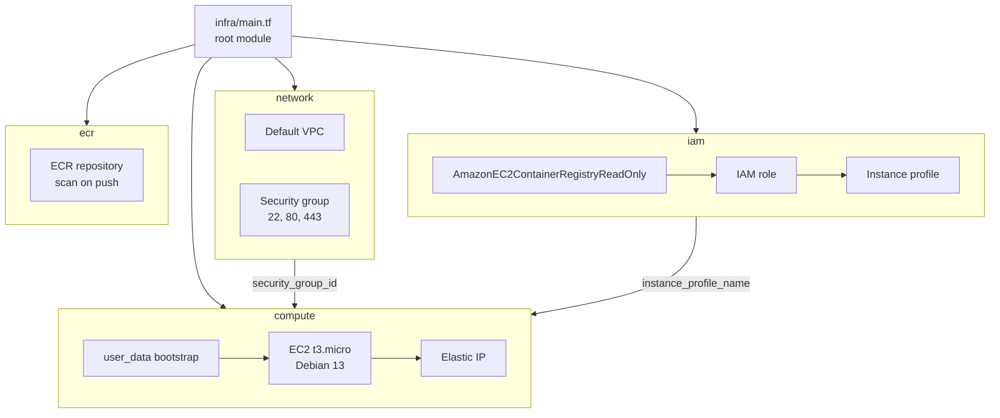

# Infrastructure

All AWS resources are defined with Terraform in [`infra/`](../infra/). The root module wires together four child modules, each with its own `variables.tf` and `outputs.tf`.



## Usage

```sh
cd infra
terraform init
terraform plan
terraform apply
```

| Variable        | Default                 | Notes                                              |
| --------------- | ----------------------- | -------------------------------------------------- |
| `project_name`  | `smol-ivan`             | Prefix for every resource name.                    |
| `aws_region`    | `us-west-2`             |                                                    |
| `key_name`      | `smol-ivan-oregon`      | Existing EC2 key pair (created outside Terraform). |
| `swap_size_gb`  | `2`                     | Size of the swap file created at boot.             |
| `ami_id`        | `ami-06a877a0bb8824880` | Pinned AMI, see [compute](#compute).               |
| `instance_type` | `t3.micro`              | Defined in the compute module.                     |

| Output               | Use                                   |
| -------------------- | ------------------------------------- |
| `server_public_ip`   | Point the DNS records at it.          |
| `ecr_repository_url` | Registry used by the deploy pipeline. |

## Modules

### network

Uses the account's **default VPC** and creates a security group allowing inbound SSH (22), HTTP (80) and HTTPS (443) from anywhere, and all outbound traffic.

The default VPC keeps things simple for a single instance. A custom VPC with public and private subnets would be the next step if more services were added.

### iam

Creates an IAM role that EC2 can assume, attaches the AWS managed policy `AmazonEC2ContainerRegistryReadOnly`, and exposes it as an instance profile.

This is what lets the server pull images from ECR **without any AWS keys stored on it**. Credentials are short-lived and rotated by AWS through the instance metadata service. The role can only read from ECR, so a compromised instance cannot push images or touch other services.

### ecr

A single private repository (`smol-ivan-web`):

- `scan_on_push = true`: every pushed image is scanned for known vulnerabilities.
- `image_tag_mutability = "MUTABLE"`: required because the pipeline overwrites `latest` on every deploy. SHA tags are never overwritten in practice.

### compute

- **EC2 `t3.micro`** with the IAM instance profile and the security group from the other modules.
- **Elastic IP**, so the public address survives stop/start cycles and DNS does not need to change.
- **Pinned AMI.** The module can look up the latest official Debian 13 AMI, but the instance is pinned to `var.ami_id`. Otherwise every new Debian image published would make `terraform plan` propose replacing the instance. OS upgrades are a deliberate change: bump the variable and plan for the replacement.

#### Bootstrap (`user_data.sh.tpl`)

Runs once, on the instance's first boot:

1. Installs Docker Engine and the Compose plugin from Docker's official apt repository.
2. Adds the `admin` user to the `docker` group, so the pipeline can run `docker` over SSH without `sudo`.
3. Creates a swap file (`swap_size_gb`) with `vm.swappiness=10`. The instance has 1 GB of RAM and runs up to five containers, so swap is a safety net against the OOM killer, not extra memory.
4. Adds a weekly cron job (Sunday 04:00) that restarts the site container so nginx loads renewed certificates (see [Runtime](runtime.md#tls)).

Since `user_data` only runs at creation, changing the template does not affect a running instance. Terraform will report the change, but applying it only takes effect if the instance is replaced.

## What is not managed by Terraform

| Item                                                 | Where it lives                                                         |
| ---------------------------------------------------- | ---------------------------------------------------------------------- |
| DNS records (`smol-ivan.xyz`, `kuma.`, `analytics.`) | Namecheap, pointed at the Elastic IP.                                  |
| EC2 key pair                                         | Created manually in AWS, referenced by name.                           |
| GitHub Actions secrets                               | Repository settings.                                                   |
| Initial TLS certificate                              | Requested once by hand (see [Runtime](runtime.md#tls)).                |
| Terraform state                                      | Local file. Moving it to an S3 backend with locking is on the roadmap. |
