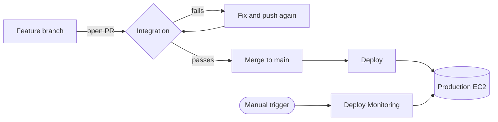
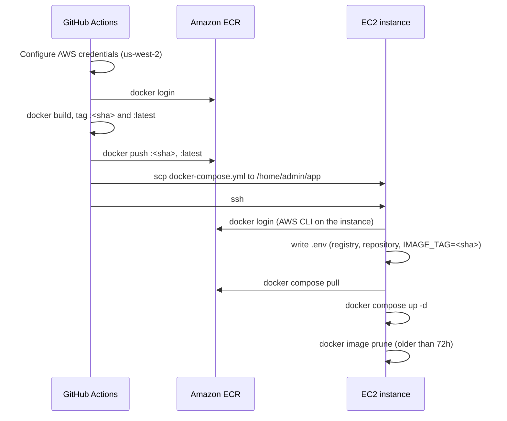

# Pipelines

All automation lives in [`.github/workflows/`](../.github/workflows/). The flow follows a simple trunk-based model: work happens on a branch, a pull request to `main` is validated, and merging to `main` deploys.



## Integration (`integration.yml`)

**Trigger:** pull request to `main` (`opened`, `reopened`, `ready_for_review`, `synchronize`).

Its goal is to catch problems before they reach `main`. It has two jobs, and the second runs only if the first passes (`needs: validate-astro`):

| Job               | Step                                           | Why                                                                                                                            |
| ----------------- | ---------------------------------------------- | ------------------------------------------------------------------------------------------------------------------------------ |
| `validate-astro`  | Set up pnpm 9 and Node.js 24 (with pnpm cache) | Same major Node version as local development.                                                                                  |
|                   | `pnpm install --frozen-lockfile`               | Fails if `pnpm-lock.yaml` is out of sync with `package.json`, so CI never resolves different versions than the ones committed. |
|                   | `prettier --check .`                           | Formatting is enforced, not suggested.                                                                                         |
|                   | `pnpm run check` (`astro check`)               | Type checking and Astro-specific diagnostics.                                                                                  |
| `validate-docker` | `docker build`                                 | Proves the production image still builds. The image is not pushed anywhere.                                                    |

Running the cheap checks first means a formatting error fails in seconds instead of after a full image build.

## Deploy (`deploy.yml`)

**Trigger:** push to `main` (in practice, a merged PR).



Key points:

- **The image is built once, in CI.** The server never builds anything, it only pulls. This keeps the `t3.micro` free of build load and guarantees that what was built is what runs.
- **`IMAGE_TAG` is the commit SHA.** `docker-compose.yml` references `${ECR_REGISTRY}/${ECR_REPOSITORY}:${IMAGE_TAG}`, so the running container always maps to one exact commit. See [ADR 0004](adr/0004-tag-images-with-commit-sha.md).
- **The Compose file is shipped on every deploy**, so changes to it (ports, volumes, limits) go through the same review and deploy path as code changes.
- **`docker image prune`** keeps the disk on the small instance from filling up with old images. Older images are still available in ECR.

## Deploy Monitoring (`deploy-monitoring.yml`)

**Trigger:** manual only (`workflow_dispatch`).

It copies `docker-compose.monitoring.yml` to the instance, writes the Umami secrets into `.env`, and runs `docker compose pull && up -d` for Uptime Kuma, Umami and Postgres. It does not touch the site.

It is manual because the monitoring stack changes rarely and should not restart on every site deploy. See [ADR 0002](adr/0002-separate-monitoring-stack.md).

## PR Agent (`pr-agent.yml`)

**Trigger:** pull request events and PR comments.

Uses [PR-Agent](https://github.com/the-pr-agent/pr-agent) with Gemini to auto-generate PR descriptions. Automatic review and code suggestions are disabled. It needs `pull-requests: write` and `issues: write`, and nothing else.

## Secrets

| Secret                                        | Used by                   | Purpose                                 |
| --------------------------------------------- | ------------------------- | --------------------------------------- |
| `AWS_ACCESS_KEY_ID` / `AWS_SECRET_ACCESS_KEY` | Deploy                    | Push images to ECR.                     |
| `EC2_HOST`                                    | Deploy, Deploy Monitoring | Elastic IP of the instance.             |
| `EC2_SSH_KEY`                                 | Deploy, Deploy Monitoring | Private key for the `admin` user.       |
| `UMAMI_DB_PASSWORD` / `UMAMI_APP_SECRET`      | Deploy Monitoring         | Umami database password and app secret. |
| `GEMINI_API_KEY`                              | PR Agent                  | LLM provider for PR descriptions.       |

The instance itself has **no AWS keys**: it pulls from ECR through its IAM instance role (see [Infrastructure](infrastructure.md#iam)).

## Rolling back

There is no automatic rollback yet. Because every image is tagged with its commit SHA and kept in ECR, rolling back manually is straightforward:

```sh
ssh admin@<EC2_HOST>
cd /home/admin/app
# set IMAGE_TAG to the SHA of the last good commit
sed -i 's/^IMAGE_TAG=.*/IMAGE_TAG=<previous-sha>/' .env
docker compose -f docker-compose.yml pull
docker compose -f docker-compose.yml up -d
```

Alternatively, revert the commit on `main` and let the pipeline deploy it, which keeps `main` and production in sync.

## Known issues

- **The site deploy overwrites `.env`.** `deploy.yml` writes it with `cat > .env`, which removes the Umami variables written by `deploy-monitoring.yml`. Running containers are unaffected (their environment is fixed at creation), but a later manual `docker compose -f docker-compose.monitoring.yml up -d` would start Umami and Postgres without their secrets. Fix: update only the site's keys, the same way the monitoring workflow does, or use one `.env` file per stack.
- **No concurrency control.** Two merges in quick succession start two deploys that can overlap on the server. A `concurrency` group on the workflow would queue them.
- **No post-deploy verification.** The pipeline succeeds once `up -d` returns, even if the new container is unhealthy. The container has a `/healthz` healthcheck that the pipeline could wait on.
- **Static AWS keys and SSH from the internet.** See the roadmap in the [main README](../README.md#known-limitations-and-roadmap).
