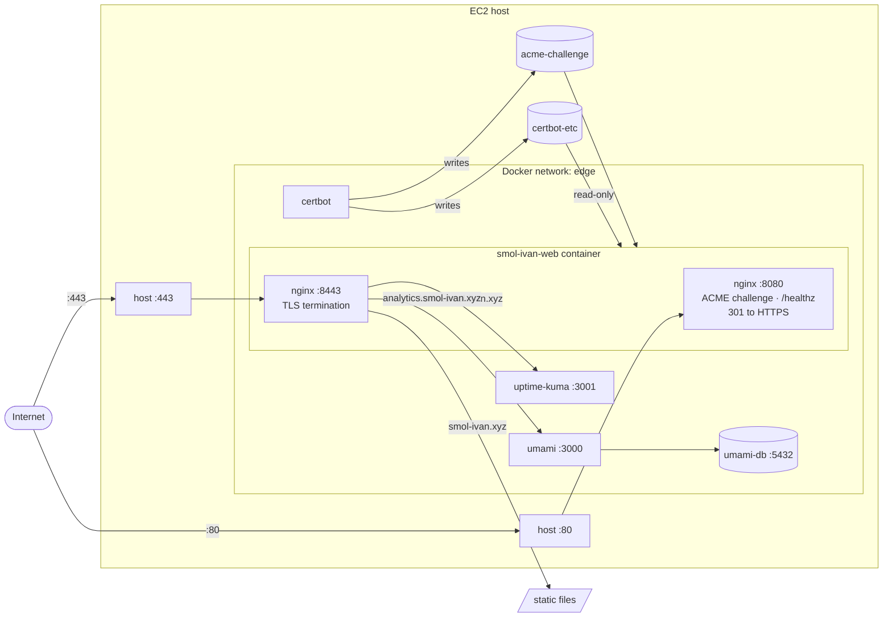

# Runtime

What actually runs on the EC2 instance, and how the pieces talk to each other.

## Container image

The [`Dockerfile`](../Dockerfile) is a multi-stage build:

1. **build** (`node:26-trixie-slim`): installs pnpm, installs dependencies from the lockfile, runs `astro build`. Dependency manifests are copied before the source code, so the dependency layer is cached as long as they do not change.
2. **runtime** (`nginx:alpine`): copies only `dist/` and the nginx config.

The final image contains no Node.js, no `node_modules` and no source code, only static files and nginx. That makes it smaller and leaves less to attack.

## Compose stacks

There are two independent stacks that share one Docker network:

| Stack      | File                                                                | Services                           | Deployed by           |
| ---------- | ------------------------------------------------------------------- | ---------------------------------- | --------------------- |
| Site       | [`docker-compose.yml`](../docker-compose.yml)                       | `smol-ivan-web`, `certbot`         | Every merge to `main` |
| Monitoring | [`docker-compose.monitoring.yml`](../docker-compose.monitoring.yml) | `uptime-kuma`, `umami`, `umami-db` | Manually              |

The site stack **creates** the `edge` network. The monitoring stack declares it as `external: true` and joins it. That is how nginx can reach Kuma and Umami by container name while the two stacks keep separate lifecycles ([ADR 0002](adr/0002-separate-monitoring-stack.md)).

Postgres publishes no ports to the host. It is only reachable from containers on `edge`.

## nginx

Defined in [`nginx/nginx.conf`](../nginx/nginx.conf). nginx listens on unprivileged ports (8080/8443) inside the container, and Compose maps them to 80/443 on the host.

| Server block | Listens                               | Purpose                                                                                                    |
| ------------ | ------------------------------------- | ---------------------------------------------------------------------------------------------------------- |
| HTTP         | 8080                                  | Serves `/.well-known/acme-challenge/` for certbot, answers `/healthz`, redirects everything else to HTTPS. |
| Site         | 8443 (TLS)                            | Serves the static build, gzip, custom 404 page.                                                            |
| Kuma         | 8443 (TLS), `kuma.smol-ivan.xyz`      | Reverse proxy with WebSocket upgrade headers (Kuma's UI depends on them).                                  |
| Umami        | 8443 (TLS), `analytics.smol-ivan.xyz` | Reverse proxy.                                                                                             |

**Upstreams are resolved at request time.** The proxy blocks use Docker's internal DNS (`resolver 127.0.0.11 valid=10s`) and a variable in `proxy_pass`. With a fixed hostname, nginx resolves it once at startup and refuses to start if the container does not exist. Since monitoring is deployed separately, the site must be able to start without it, and keep working when Kuma or Umami restart with a new IP.

## TLS

Certificates come from Let's Encrypt, handled by a `certbot` sidecar container ([ADR 0003](adr/0003-certbot-sidecar-for-tls.md)). One certificate covers the apex, `www`, `kuma` and `analytics` names.

Two named volumes connect certbot and nginx:

- **`acme-challenge`**: certbot writes the HTTP-01 challenge token, and nginx serves it on port 80.
- **`certbot-etc`**: certbot writes the certificates, and nginx mounts them **read-only**.

Lifecycle:

1. **First issuance (manual, once).** The Compose service only renews, so the first certificate has to be requested by hand with certbot in webroot mode against the `acme-challenge` volume.
2. **Renewal (automatic).** The certbot container runs `certbot renew` every 12 hours. Certbot only renews when the certificate is close to expiring.
3. **Reload (scheduled).** nginx reads certificates at startup, so a weekly cron job on the host restarts the site container. Each deploy also recreates the container. Let's Encrypt certificates last 90 days and renew around day 60, so a weekly restart leaves plenty of margin.

## Resource limits and logging

All containers have CPU and memory limits, so one misbehaving service cannot take down the whole instance:

| Service         | CPU  | Memory |
| --------------- | ---- | ------ |
| `smol-ivan-web` | 0.50 | 256 MB |
| `uptime-kuma`   | 0.25 | 150 MB |
| `umami`         | 0.25 | 200 MB |
| `umami-db`      | 0.25 | 200 MB |

Logs use the `json-file` driver with rotation (`max-size: 10m`, `max-file: 3`). Without rotation, container logs grow until the disk is full.

## Health checks

- `smol-ivan-web`: `wget --spider http://127.0.0.1:8080/healthz` every 30s. `/healthz` is served on the HTTP block, so it does not depend on TLS being configured.
- `umami-db`: `pg_isready`. Umami uses `depends_on: condition: service_healthy`, so it waits for the database to accept connections, not just for the container to start.
- Uptime Kuma's monitors are configured in its own UI, not in this repository.
